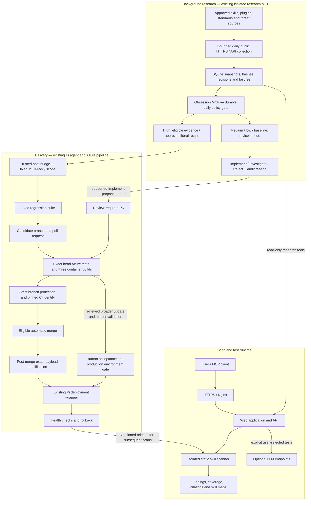

# Injecticide architecture — 0.14.0

Implementation architecture. Deployment and live acceptance are recorded
separately in `docs/validation/`; a diagram is not deployment evidence.

- Scans do not initiate research. A running process retains its cached release
  catalog; publication changes subsequent processes rather than in-flight rules.
- Internet content is untrusted evidence. It cannot supply approval, code, regex,
  file paths, shell commands or release credentials. The collector has no Git or
  deployment credentials, host checkout write mount or Docker socket.
- The automatic lane permits only `research_mcp/obsession_updates.json` and
  `skill_sandbox/rules/obsession_signatures.json`. Novel literal indicators request
  contextual review; they do not prove malicious intent. Shipped recipes are
  empty; adding a recipe requires local policy review.
- Initial baselines and community submissions require review. Unsupported new
  code changes require engineering work and human acceptance.
- Branch protection, exact CI identity, current evidence and post-merge
  qualification must all pass. Missing prerequisites block automatic release.
- Source search, runtime correctness, compliance, vulnerability applicability and
  operational deployment are separate outcomes. New external cost requires
  advance approval. See the source assessment for collection and access limits.
