# Injecticide architecture overview

```mermaid
flowchart LR
    Sources["Skills, plugins<br/>standards and threats"] --> Research["Research MCP<br/>Daily collection<br/>Versioned evidence"]
    Research --> Gate{"Obsession<br/>policy gate"}
    Gate -->|eligible high signal| Delivery["Trusted host bridge<br/>Tests and scoped PR"]
    Gate -->|medium / low| Review["Human review<br/>Implement / investigate / reject"]
    Review -->|approved supported update| Delivery
    Delivery --> CI["Azure pipeline<br/>Exact-revision validation<br/>Release qualification / approval"]
    CI --> Pi["Pi deployment<br/>Health checks and rollback"]
    Pi --> Web["Nginx + Web API<br/>Reports and playground"]
    Web --> Scanner["Isolated skill scanner<br/>Fixed release snapshot"]
    Scanner --> Evidence["Findings, coverage<br/>Citations and skill maps"]
    Research -.->|read-only research| Web
    Web -->|explicit endpoint tests| Models["Optional LLM services"]
```

Background research never changes in-flight scan rules. Automatic publication
requires all configured release prerequisites; broader changes retain human
acceptance. Full trust boundaries and limitations appear in
[the detailed architecture](injecticide-0-14.md). Deployment state is recorded
separately from this implementation diagram.
